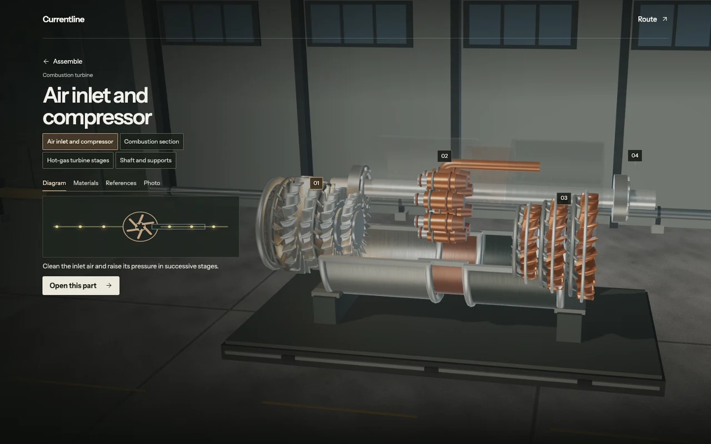

# Currentline

Currentline is an interactive 3D field guide to electrical energy. Choose natural gas, nuclear, solar, wind, or hydroelectric generation and follow the conversions through the grid, a data center, and a server down to its processor.

Select an energy source and begin the full-screen tour. The timeline and playback controls move between stops. **Route** opens the synchronized diagram and power branches, and **Details** opens the component explanation. Select equipment in the scene or open a cutaway to examine it more closely.



## Run locally

Use Node.js 22 LTS or newer. The project was also tested with Node.js 20.18.0.

```sh
git clone https://github.com/iss24k/currentline.git
cd currentline
npm ci
npm run dev
```

Open the loopback URL printed by Vite, normally `http://127.0.0.1:5173`. The experience runs locally and needs no account, API key, or hosted backend. For the 3D viewer, use a WebGL 2-capable browser. The journey map, inspector, guide and bibliography also work when WebGL 2 is unavailable. **Reduce motion** follows your system preference initially and can be changed under **About** or **Route → Field guide**. Drag to orbit, scroll or press +/− to zoom, and double-click or press 0 to reset.

## The architecture in the exhibit

Currentline follows one protected IT power path in a representative **U.S. 60 Hz AC data center**. The core of the facility example follows Eaton’s documented topology. The upstream voltage levels, equipment choices and server rail are teaching examples.

- **Utility power:** 230 kV transmission → 13.8 kV feeder → site intake → 480Y/277 V distribution → transfer gear → online UPS.
- **Battery bridge:** after loss of utility power, battery DC feeds the UPS inverter while the standby generator starts.
- **Generator online:** transfer gear selects generator AC once available. The UPS again converts incoming AC to DC and back to AC.
- **Downstream:** UPS → floor PDU transformer at 208Y/120 V → busway → rack PDU → 208 V AC server cord → 12 V DC supply → board regulator at about 1 V DC for the example core rail.

The field guide explains AC, DC, voltage, power and energy, plus other facility layouts and DC rack architectures. Equipment geometry, spacing, timing and voltage levels are schematic. The grid combines electricity from multiple sources. Moving lights represent energy transfer, and charge carriers move locally. This project is an educational exhibit. Detailed protection coordination, facility redundancy and cooling are outside its scope.

## Research

The app’s **Sources** panel lists 54 references, with relevant links on all 27 component cards. The bibliography and supporting notes live in [`src/content.js`](src/content.js). Representative starting points:

- [U.S. Energy Information Administration — How electricity is generated](https://www.eia.gov/energyexplained/electricity/how-electricity-is-generated.php) and [how electricity is delivered](https://www.eia.gov/energyexplained/electricity/delivery-to-consumers.php)
- [U.S. Department of Energy — How gas turbine power plants work](https://www.energy.gov/hgeo/how-gas-turbine-power-plants-work), [nuclear reactor basics](https://www.energy.gov/ne/articles/nuclear-101-how-does-nuclear-reactor-work), [solar PV system design](https://www.energy.gov/cmei/systems/solar-photovoltaic-system-design-basics), [how wind turbines work](https://www.energy.gov/cmei/systems/how-do-wind-turbines-work), and [how hydropower works](https://www.energy.gov/cmei/water/how-hydropower-works)
- [Eaton — Selecting Protective Devices Handbook, data center diagram](https://www.eaton.com/content/dam/eaton/products/electrical-circuit-protection/fuses/short-circuit-current-ratings/bus-ele-an-3002-spd.pdf#page=231)
- [Supermicro — Example 12 V server PSU](https://store.supermicro.com/us_en/800w-1u-pws-804p-1r.html) and [Texas Instruments — Example 12 V to 1 V regulator](https://www.ti.com/tool/PMP21872)

## How the project is organized

[Three.js](https://threejs.org/docs/pages/WebGLRenderer) provides the real-time camera, lighting, mesh picking and procedural geometry. [Vite](https://v6.vite.dev/guide/) builds the static app. Native HTML controls, CSS and JavaScript keep the learning content and navigation independent of the renderer. Fonts and icons are bundled locally. The 3D equipment and lighting are original procedural assets. The opening photograph is Charles Devaux’s [Power lines](https://commons.wikimedia.org/wiki/File:Power_lines_(Unsplash).jpg), available under [CC0 1.0](https://creativecommons.org/publicdomain/zero/1.0/).

| File | Purpose |
| --- | --- |
| `src/content.js` | Component explanations, glossary, architectural notes and bibliography |
| `src/route.js` | Source branches, power states, stop order and model placement |
| `src/generation-models.js`, `src/infrastructure-models.js` | Model factories, rotors and cutaways |
| `src/stage.js` | Camera, scene, energy traces, hotspots and mesh picking |
| `src/main.js`, `src/style.css` | Controls, component inspector and diagrams |

## Verify the build

```sh
npm test
npm run build
npm run preview -- --port 4173 --strictPort
```

With the preview running, use another terminal to run the browser suite.

```sh
npx playwright install chromium
npm run test:browser
```

You can use an installed Google Chrome with `CURRENTLINE_BROWSER=chrome npm run test:browser`. The suite traverses all five generation paths and three supply states, exercises the 3D controls and diagram, checks reduced motion and the WebGL fallback, runs axe-core checks, and captures screenshots in the ignored `test-results/` directory.
